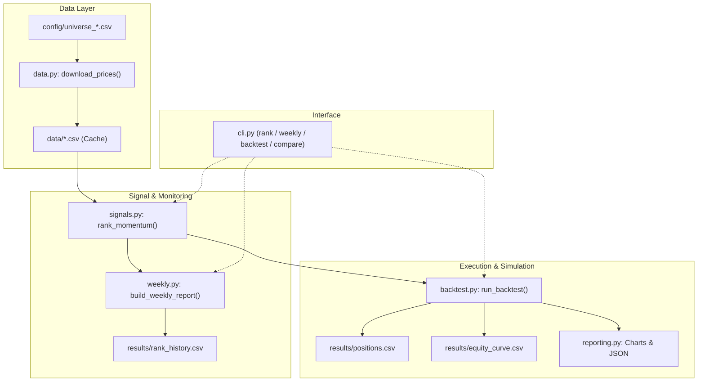
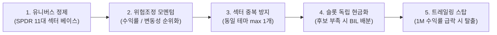

# ETF 모멘텀 전략 및 코드베이스 종합 검토 보고서

**대상 프로젝트**: [`etf_momentum_strategy`](file:///Users/dc_macair/Documents/Research/etf_momentum_strategy)  
**작성일**: 2026-09-20  
**평가 목적**: 소프트웨어 엔지니어링 완성도, 퀀트/금융 전략 타당성, 실전 백테스트 성과 원인 분석 및 개선안 도출  

---

## 1. 종합 평가 요약 (Executive Summary)

| 평가 영역 | 평점 | 핵심 평가 내용 |
| :--- | :---: | :--- |
| **소프트웨어 엔지니어링** | **9.5 / 10** | 모듈화, 타입 힌트, CLI 편의성, 테스트 코드, 패키지 관리(`uv`) 등 매우 뛰어남 |
| **백테스트 정밀도** | **8.0 / 10** | Lookahead bias 방지, 거래일 캘린더 정합성 우수. 단, 일일 리밸런싱 가정 및 비중 표류 반영 필요 |
| **퀀트 전략 및 팩터 설계** | **6.5 / 10** | 12-1 정통 모멘텀 공식 구현 양호. 다만 룩백 후행성(Lag)과 모멘텀 붕괴(Crash)에 취약 |
| **리스크 관리 & 자산 배분** | **5.5 / 10** | 종목 부족 시 몰빵 현상, 동일 테마 중복 편입, 고베타 버블 자산 선별 필터 부재 |

> [!NOTE]
> **핵심 진단 결과**  
> 코드베이스의 아키텍처와 완성도는 개인/연구용 프로젝트 수준을 훨씬 뛰어넘는 수준입니다.  
> 그러나 백테스트 결과에서 **전략이 벤치마크(SPY) 대비 저조한 성과(CAGR: 11.0% vs 16.9%, MDD: -40.5% vs -33.7%)**를 기록한 근본 원인은 코드 버그가 아니라, **고베타 테마주 편향, 장기 룩백(12개월)의 후행성, 그리고 종목 부족 시 몰빵되는 자산배분 로직**에 기인합니다.

---

## 2. 시스템 아키텍처 및 모듈 구조



### 모듈별 주요 역할
- [`data.py`](file:///Users/dc_macair/Documents/Research/etf_momentum_strategy/src/etf_momentum/data.py): Yahoo Finance 데이터 다운로드, 가격 정제, 티커별 캐싱 기능 제공.
- [`signals.py`](file:///Users/dc_macair/Documents/Research/etf_momentum_strategy/src/etf_momentum/signals.py): 3/6/12개월 모멘텀 계산, 1개월 스킵(`skip_days=21`), 200 SMA 추세 필터, 변동성 산출.
- [`backtest.py`](file:///Users/dc_macair/Documents/Research/etf_momentum_strategy/src/etf_momentum/backtest.py): 리밸런싱 주기별 가중치 할당, 회전율 및 거래비용 반영, 성과 지표(CAGR, MDD, Sharpe, Calmar) 산출.
- [`weekly.py`](file:///Users/dc_macair/Documents/Research/etf_momentum_strategy/src/etf_momentum/weekly.py): 이전 주차 순위와의 델타 추적(`still_top`, `new_or_rising`, `leader_fading`, `one_month_rolling_over`).
- [`cli.py`](file:///Users/dc_macair/Documents/Research/etf_momentum_strategy/src/etf_momentum/cli.py): 4가지 명령어(`rank`, `weekly`, `backtest`, `compare`) 및 다차원 그리드 탐색 지원.

---

## 3. 코드 구현 디테일 및 엣지 케이스 분석

### ① [중대] 후보군 부족 시 '단일 자산 몰빵' 위험
[`backtest.py`의 `_select_weights`](file:///Users/dc_macair/Documents/Research/etf_momentum_strategy/src/etf_momentum/backtest.py#L124-L131) 및 [`_selected_weights`](file:///Users/dc_macair/Documents/Research/etf_momentum_strategy/src/etf_momentum/backtest.py#L134-L154):
```python
selected = ranking[ranking["eligible"]].head(config.top_n)["ticker"].tolist()
# 만약 eligible한 종목이 1개뿐이라면 selected는 [TICKER] (길이 1)
selected_weights = _selected_weights(ranking, selected, config)
# raw / raw.sum() 정규화로 인해 1개 종목에 100% 비중 부여!
```
- **문제점**: 하락장으로 인해 대다수 ETF가 200 SMA 아래로 내려가고 모멘텀이 꺾여 `top_n=3` 중 1개만 조건을 통과한 경우, **시스템은 남은 1개 종목에 포트폴리오 100%를 올인**합니다.
- **`max_position_weight` 무력화**: [`_cap_weights`](file:///Users/dc_macair/Documents/Research/etf_momentum_strategy/src/etf_momentum/backtest.py#L156-L171) 함수에서 `cap=0.5`를 적용하더라도, 종목이 1개뿐이면 마지막에 `capped / capped.sum()`을 하면서 다시 1.0(100%)으로 복원됩니다.
- **해결 방안**: 후보 종목 수가 `top_n`보다 부족하면, 부족한 슬롯만큼 현금성 ETF(`cash_ticker`)로 분산해야 합니다.

### ② 일일 리밸런싱 가정 (Daily Rebalancing Drag)
[`backtest.py` L53](file:///Users/dc_macair/Documents/Research/etf_momentum_strategy/src/etf_momentum/backtest.py#L53):
```python
period_returns = returns.loc[holding_dates, weights.index].mul(weights, axis=1).sum(axis=1)
```
- **분석**: 1개월 보유 기간 중 매일 동일한 `weights`를 일간 수익률과 곱하여 더합니다. 이는 매일 장마감 시점에 포트폴리오를 초기 비중으로 되돌리는 **일일 리밸런싱(Daily Rebalanced Portfolio)**을 가정합니다.
- **영향**: 실제 1개월 바이앤홀드는 한 달 동안 가격이 오른 자산의 비중이 늘어나는 표류(Drift)가 발생합니다. 지수/ETF에서는 차이가 아주 크진 않으나 벤치마크 대비 약간의 복리 왜곡(Volatility Drag/Bonus)을 유발합니다.

### ③ 랭킹 지표와 비중 방식의 엇박자
- [`signals.py` L84](file:///Users/dc_macair/Documents/Research/etf_momentum_strategy/src/etf_momentum/signals.py#L84)에서 `risk_adjusted_score = weighted_momentum / realized_vol`을 유용하게 계산하고 있습니다.
- 그러나 [`rank_momentum`](file:///Users/dc_macair/Documents/Research/etf_momentum_strategy/src/etf_momentum/signals.py#L118-L122)의 정렬 기준은 여전히 `weighted_momentum`(단순 수익률 가중합)으로 고정되어 있습니다.
- CLI에서 `--weighting risk_adjusted_score`를 주더라도, 이미 단순 수익률로 뽑힌 상위 `top_n` 안에서 비중만 조절할 뿐 **위험조정 점수가 우수한 종목을 발굴하지는 못합니다**.

---

## 4. 백테스트 성과 부진 원인 분석 (Financial & Quant Analysis)

저장된 [`results/summary.json`](file:///Users/dc_macair/Documents/Research/etf_momentum_strategy/results/summary.json) 결과:
```json
{
  "benchmark_cagr": 0.16887,
  "benchmark_max_drawdown": -0.33717,
  "benchmark_sharpe_like": 0.92579,
  "strategy_cagr": 0.10995,
  "strategy_max_drawdown": -0.40526,
  "strategy_sharpe_like": 0.48256
}
```

### 왜 SPY 지수 추종보다 수익률은 낮고 낙폭은 컸을까?

#### 1) 모멘텀 붕괴(Momentum Crash)와 12개월 룩백의 후행성
[`results/positions.csv`](file:///Users/dc_macair/Documents/Research/etf_momentum_strategy/results/positions.csv)의 2020~2021년 포트폴리오 내역:
- **2020년 9월 ~ 2021년 5월**: 클린에너지/태양광 ETF인 `TAN`, `ICLN`을 지속 보유.
- **상황**: `TAN`은 2020년에 230% 이상 폭등한 후 2021년 1월 정점을 찍고 반토막(-50%)이 났습니다.
- **원인**: 가중치 `(0.3, 0.3, 0.4)` 구조상 12개월 수익률(0.4)과 6개월 수익률(0.3)이 전체 점수의 70%를 차지합니다. 1월에 주가가 꺾이기 시작해도 과거 1년 누적 수익률이 워낙 압도적이고 200일선 위에 머물러 있었기 때문에, **전략은 주가가 40% 이상 폭락하는 3~5개월 내내 떨어지는 칼날을 매달 재매수**했습니다.

#### 2) 유니버스 중복 및 고베타 테마 쏠림
[`universe_us_sectors.csv`](file:///Users/dc_macair/Documents/Research/etf_momentum_strategy/config/universe_us_sectors.csv) 내역:
- `SMH`와 `SOXX`가 동시에 포함되어 있습니다. 두 ETF는 모두 미국 필라델피아 반도체 지수 추종 성격으로 상관계수가 0.98 이상입니다.
- 실제로 백테스트 내역에서 반도체 상승기마다 `top_n=3` 중 2자리를 `SMH`, `SOXX`가 차지하여 **포트폴리오의 66.7%가 단일 산업에 몰빵**되었습니다.
- 또한 원자력(`URA`), 바이오(`XBI`), 태양광(`TAN`) 같은 초고변동 테마주가 일반 섹터(금융, 헬스케어, 필수소비재 등)보다 변동성이 2~3배 높기 때문에, 강세장 후반부에는 항상 고베타 거품 자산이 상위를 독식하게 됩니다.

#### 3) 200 SMA의 휩소(Whipsaw) 손실
- 2020년 3월 코로나 폭락장에서 200일선 하향 돌파로 현금화(`BIL`)된 후, 시장이 V자로 급반등할 때 200일선을 회복할 때까지 3~4개월 동안 상승 랠리를 놓쳤습니다.
- 2018년 4분기 급락장에서도 비슷한 휩소 손실이 발생하여 지수 대비 언더퍼폼이 누적되었습니다.

---

## 5. 실전 투자를 위한 5대 개선 로드맵



### 개선 1. 랭킹 기준을 '위험조정 모멘텀(Risk-Adjusted Score)'으로 변경
고변동 거품 테마주가 1위를 독식하는 현상을 방지하기 위해 랭킹 정렬 지표를 모멘텀/변동성 비율로 바꿉니다.

```python
# signals.py 개선안
ranking["score"] = ranking["weighted_momentum"] / ranking["realized_volatility"]
ranking["rank"] = ranking["score"].rank(ascending=False, method="first").astype(int)
```

### 개선 2. 슬롯 독립적 현금 배분 (Partial Cash Allocation)
`top_n=3` 기준 통과 ETF가 1개뿐일 때 100% 몰빵하는 치명적 문제를 해결합니다.

```python
# backtest.py _select_weights 개선안
def _select_weights(ranking: pd.DataFrame, prices: pd.DataFrame, rebalance_date: pd.Timestamp, config: BacktestConfig) -> pd.Series:
    weights = pd.Series(0.0, index=prices.columns)
    # ... 벤치마크 필터 검사 ...
    
    eligible = ranking[ranking["eligible"]].head(config.top_n)
    selected_count = len(eligible)
    
    if selected_count == 0:
        return _cash_weights(weights, config)
    
    # 슬롯당 기본 배분 비중 (예: 3개 슬롯이면 슬롯당 1/3)
    slot_weight = 1.0 / config.top_n
    for ticker in eligible["ticker"]:
        weights[ticker] = slot_weight
        
    # 빈 슬롯은 현금(BIL)으로 채워 하락장 방어
    cash_slots = config.top_n - selected_count
    if cash_slots > 0 and config.cash_ticker and config.cash_ticker in weights.index:
        weights[config.cash_ticker] = cash_slots * slot_weight
        
    return weights
```

### 개선 3. 동일 섹터/산업군 중복 편입 캡 (Sector Constraint)
`SMH`와 `SOXX`, `TAN`과 `ICLN`처럼 동일 섹터가 2개 이상 선택되지 않도록 유니버스 메타데이터의 `category`를 기준으로 최대 1개만 허용합니다.

```python
# signals.py 또는 backtest.py 내부
filtered_selected = []
seen_categories = set()
for _, row in ranking[ranking["eligible"]].iterrows():
    if row["category"] not in seen_categories or row["category"] in ["SPDR Sector", "Broad Growth"]:
        filtered_selected.append(row["ticker"])
        seen_categories.add(row["category"])
    if len(filtered_selected) == config.top_n:
        break
```

### 개선 4. 조기 위험 회피 룰 (Trailing Stop / Fast De-risking)
12개월 모멘텀의 긴 후행성을 보완하기 위해, `weekly.py`에서 계산하는 `one_month_rolling_over` 신호나 최근 1개월 수익률 급락(`return_1m < -5%`) 조건을 결합하여 손절 및 현금화 속도를 높입니다.

### 개선 5. 유니버스 레이어 분리
- **Step 1 (안정형 코어)**: S&P 500 11개 정규 섹터(XLK, XLF, XLE, XLV, XLI, XLP, XLU, XLY, XLB, XLRE, XLC)만으로 1차 백테스트 수행하여 순수 섹터 로테이션 알파 검증.
- **Step 2 (위성 테마)**: 반도체(SMH 1종만 유지, SOXX 제외), 금(GLD), 국채(TLT) 등 상관관계가 낮은 자산군만 선별 추가.

---

## 6. 결론

사용자님의 코드는 **소프트웨어 설계와 실행 유틸리티 측면에서 이미 프로덕션에 준하는 훌륭한 틀**을 갖추고 있습니다.  
전략의 수익률과 낙폭을 극적으로 개선하기 위해 필요한 것은 코드의 재작성이 아니라, **'슬롯별 현금 배분', '위험조정 랭킹 정렬', '유니버스 중복 제거'**라는 3가지 퀀트 리스크 관리 규칙의 추가입니다.
